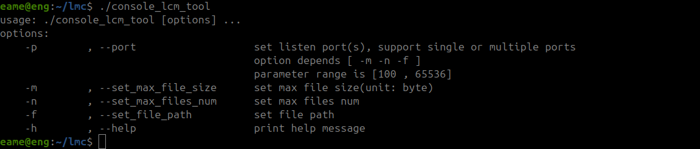
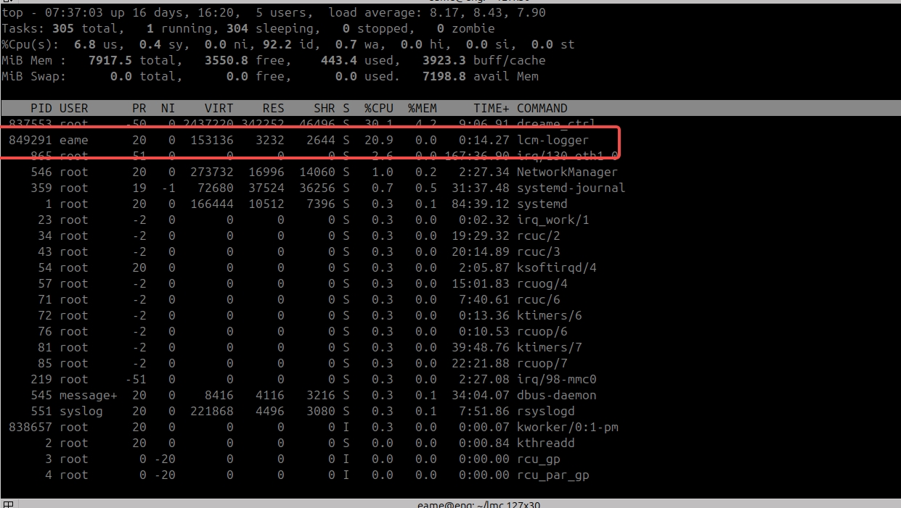
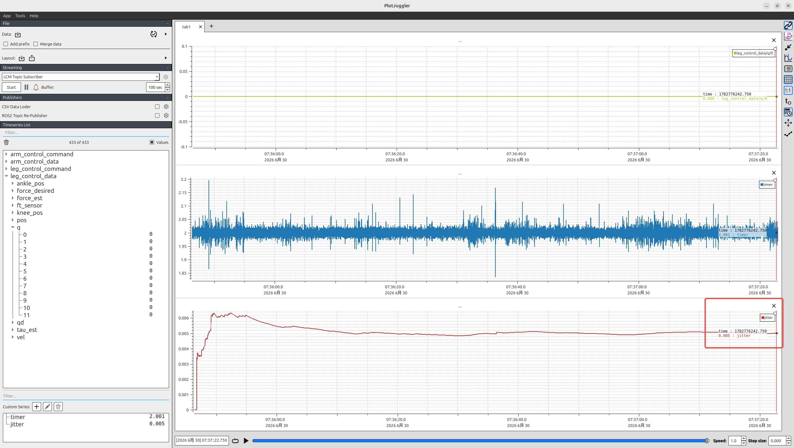
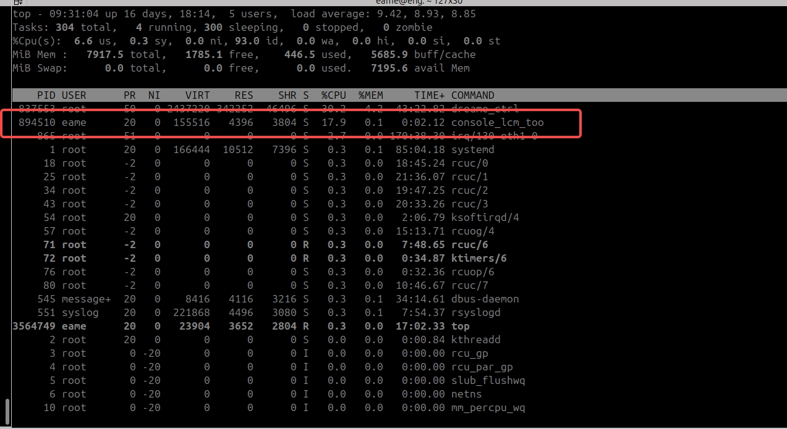
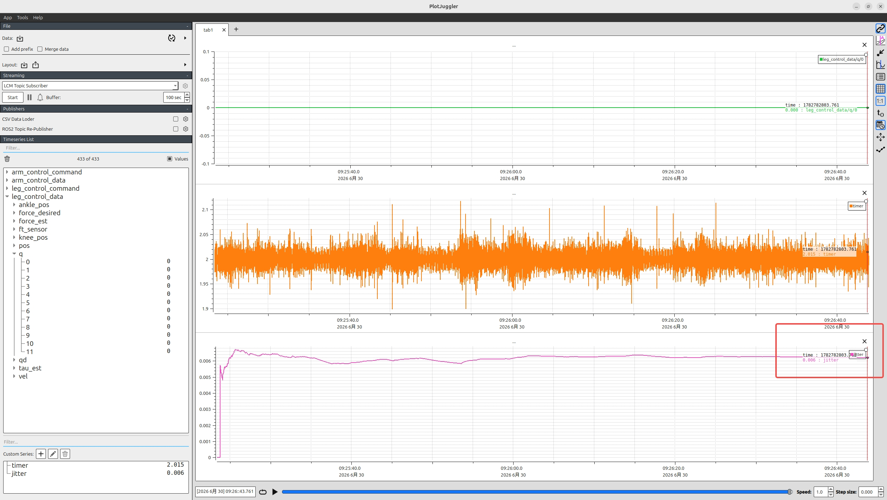

# console_lcm_tool 简单说明
## 功能描述
- 支持lcm多端口同时录制，支持文件滚动录制

- X86_64平台编译构建: g++ main.cpp -llcm
- aarch64平台编译构建: ./build_console_lcm_tool.sh (请在rk3588_v4容器内部编译构建)

- 

- 用法示例 ./console_lcm_tool -p 7667 7668 7880 -m 120000000 -n 3 -f ./lcm_too

## console_lcm_tool 与 lcm-logger(官方) 性能指标对比报告
### 一、统一测试环境
- **系统环境**：Ubuntu 22.04 PREEMPT-RT 实时内核
- **测试负载**：机器人满载 LCM 数据流，核心控制话题 500Hz（2ms 周期）
- **硬件环境**：RK3588

### 二、测试数据
#### lcm-logger(官方)
- 
- 

#### console_lcm_tool
- 
- 

### 三、总览
| 性能指标 | lcm-logger（官方） | console_lcm_tool | 指标说明 |
|--------|--------------------|--------------------------|----------|
| 物理内存 RSS | 3232KB | 4396KB | 物理内存消耗无明显差异 |
| CPU 总占用 | 20.9% | 17.9% | console_lcm_tool cpu消耗更低 |
| 峰值抖动 | 0.195ms | 0.12ms | console_lcm_tool抖动峰值更低 |
| 周期抖动率（@2ms） | 0.5% | 0.6% | 周期抖动率无明显差异 |