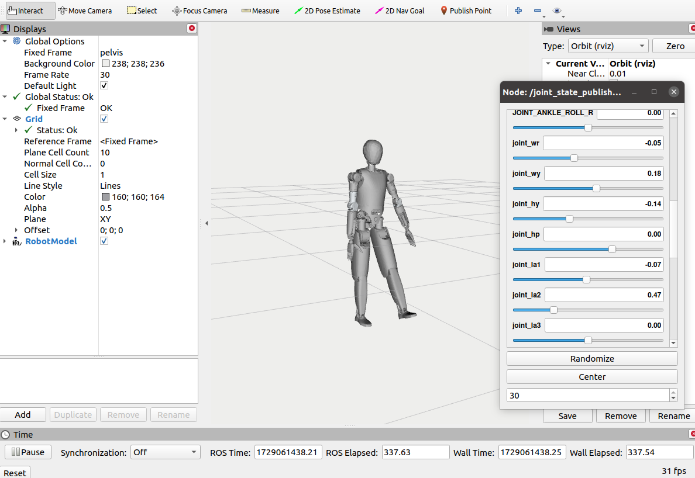
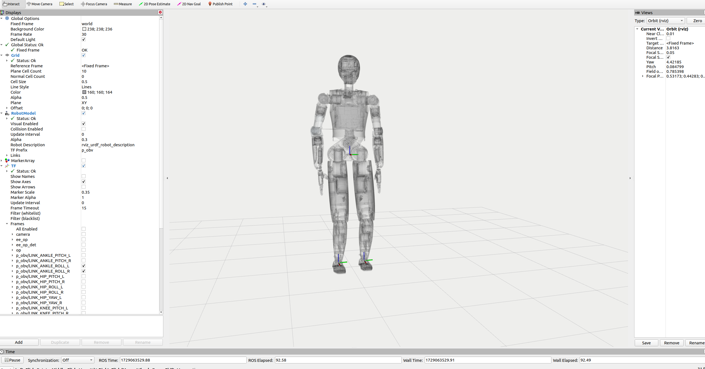
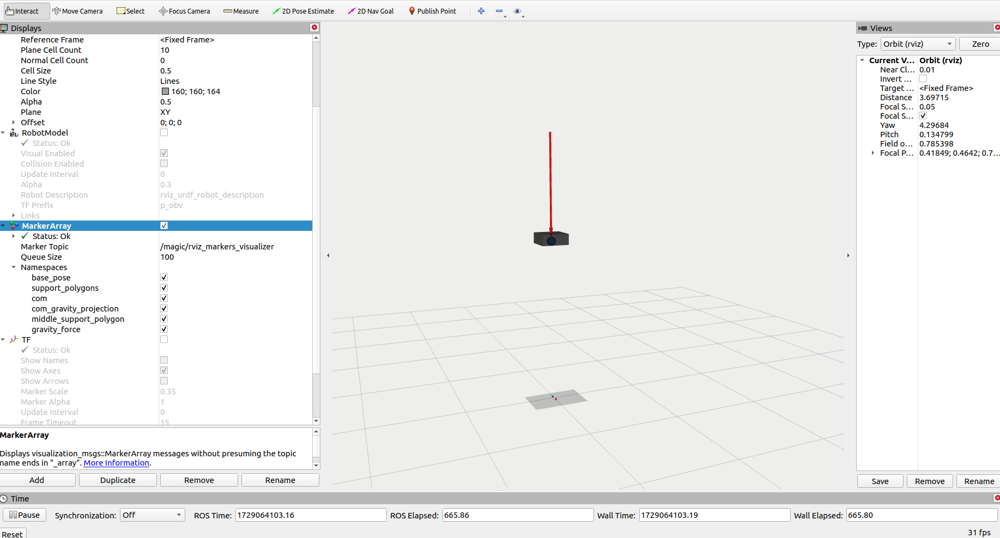

# Magic Vis
针对人形机器人的可视化工具，基于ROS1，当前囊括了 `p3b` `p4` `p5` 三款机器人。
包括以下几种功能：

## 检查 urdf
检查urdf关节方向、范围，手动调整关节角度。

  ```bash
  cd ~/robot_tools/catkin_ws
  source devel/setup.bash
  roslaunch magic_vis robot_rviz.launch robot:=p4 # p3b p4 p5
  ```
  


## 可视化
在线数据流或录制的离线数据流，可视化关键信息，辅助调试与实验结果分析。

* 世界系下本体 configuration 以及关节所在 frame 可视化

  | topic name | msg type | used data |
  |:---:|:---:|:---:|
  | `/lcm_to_ros/state_estimator`    | `lcm_to_ros::state_estimator_lcmt`    | `float32[3] p` & `float32[4] quat` |
  | `/lcm_to_ros/leg_control_data`   | `lcm_to_ros::leg_control_data_lcmt`   | `float32[12] q` |
  | `/lcm_to_ros/arm_control_data`   | `lcm_to_ros::arm_control_data_lcmt`   | `float32[14] joint_curPos` |
  | `/lcm_to_ros/waist_control_data` | `lcm_to_ros::waist_control_data_lcmt` | `float32[2] q` |
  | `/lcm_to_ros/head_control_data`  | `lcm_to_ros::head_control_data_lcmt ` | `float32[2] q` |

  

* 关键 `marker` 可视化
  完善中。。。
  
  